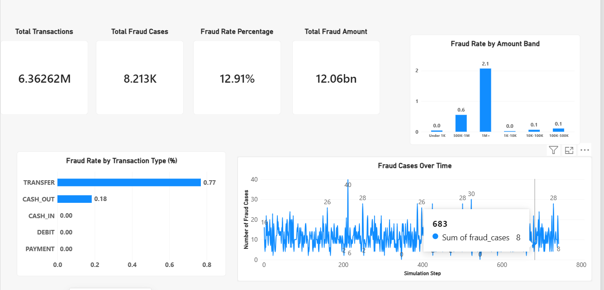
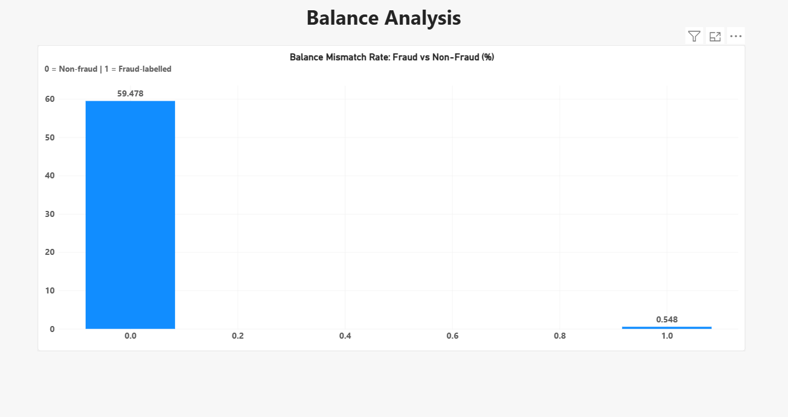

# Transaction Exceptions & Fraud Analysis

## Project Overview

This project analyzes synthetic financial transaction data from the PaySim dataset to identify patterns in fraud-labelled transactions. It uses Python, SQL/SQLite, and Power BI to explore transaction types, amounts, time patterns, and balance mismatches.

## Tools & Technologies

- **Python:** Data exploration and analysis
- **Pandas:** Data processing
- **SQL / SQLite:** Querying more than 6.3 million transactions
- **Power BI:** Interactive dashboard and visual reporting

## Dataset

The PaySim dataset contains approximately 6.36 million synthetic transactions, including transaction types, amounts, account balance fields, and fraud labels.

## Key Findings

- **6,362,620** transactions were analyzed.
- **8,213** transactions were labelled as fraud, representing approximately **0.1291%** of all transactions.
- Fraud-labelled transactions occurred in the `TRANSFER` and `CASH_OUT` categories in this dataset.
- `TRANSFER` had a higher fraud-labelled transaction rate than `CASH_OUT`.
- Transactions in the highest amount band (`1M+`) had the highest observed fraud rate among the analyzed amount bands.
- The simplified balance mismatch rate was approximately **59.478%** for non-fraud-labelled transactions and **0.548%** for fraud-labelled transactions. This rule was not a reliable standalone fraud indicator in this dataset.

## Power BI Dashboard

The report contains two pages:

1. **Fraud Analysis Overview** — KPI cards, fraud rate by transaction type, fraud cases over time, and fraud rate by transaction amount band.
2. **Balance Analysis** — comparison of simplified balance mismatch rates between fraud-labelled and non-fraud-labelled transactions.

**Power BI report:** `reports/Transaction_Fraud_Analysis.pbix`

Open the PBIX file with Power BI Desktop to explore the report interactively.

### Dashboard Screenshots

#### 1. Fraud Analysis Overview

This dashboard presents key fraud metrics, fraud rates by transaction type, fraud cases over time, and fraud rates by transaction amount band.

#### 2. Balance Analysis

This dashboard compares balance mismatch rates between fraud-labelled and non-fraud transactions.

**Interactive Power BI Report:** Open [`Transaction_Fraud_Analysis.pbix`](reports/Transaction_Fraud_Analysis.pbix) in Power BI Desktop to explore the report interactively.

## Limitations

- PaySim is a synthetic dataset; results should not be assumed to represent real-world banking fraud.
- Association between transaction amount and fraud labels does not establish causation.
- Fraud labels are treated as the dataset's reference labels, not independently verified real-world cases.
- Balance mismatch is based on a simplified formula and should not be interpreted as proof of fraud.
- `transaction_sample.csv` is intended for transaction-level inspection and should not be used to calculate unbiased dataset-wide rates.

## Future Improvements

- Develop and evaluate a machine-learning fraud classification model.
- Investigate transaction sequences and account-level behavior.
- Add more robust anomaly detection and model evaluation metrics.
- Improve dashboard filtering and drill-through analysis.

## Disclaimer

This project is for educational and portfolio purposes only. The dataset is synthetic and does not contain verified real-world fraud cases.
